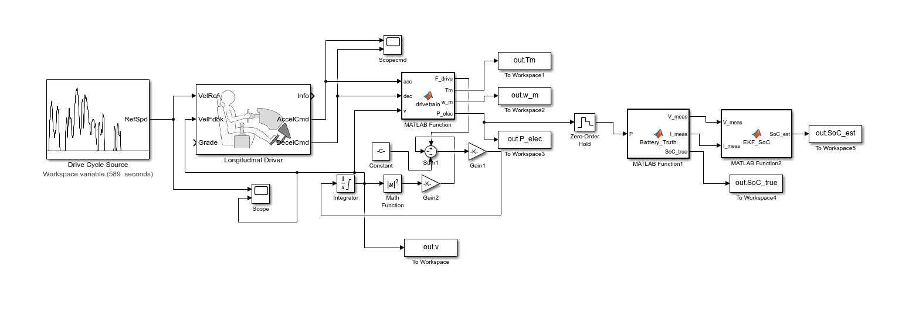
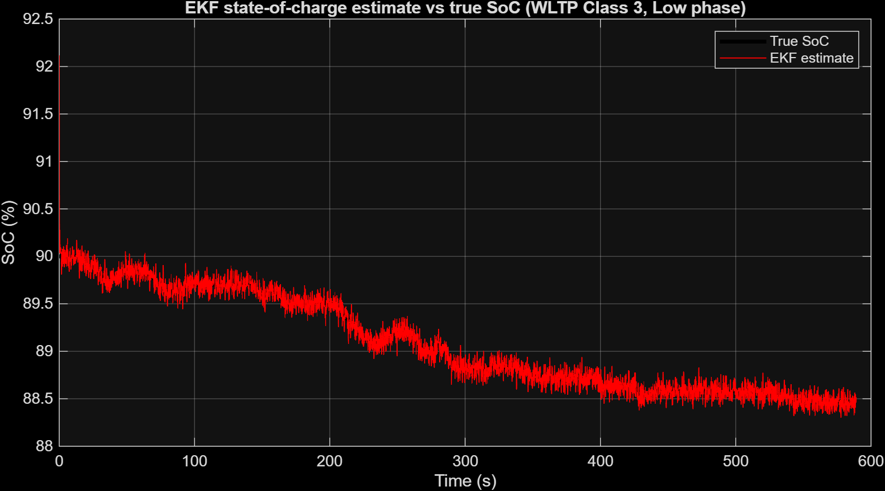
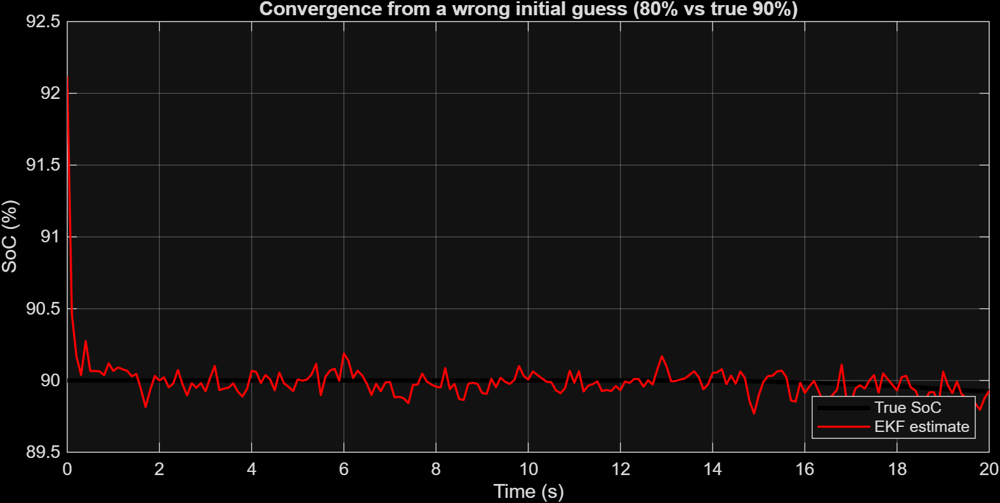
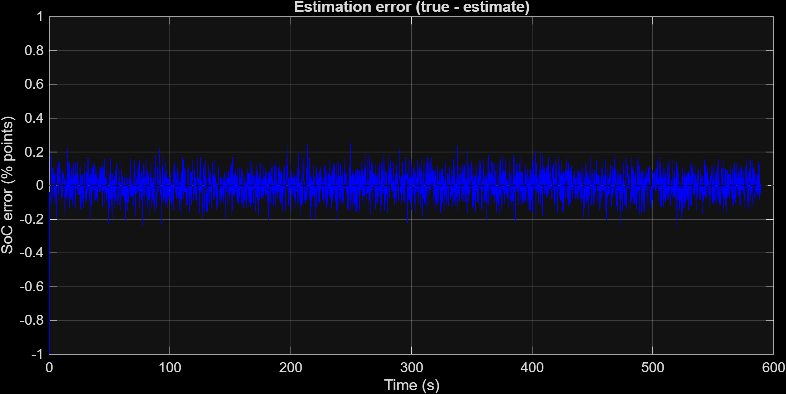
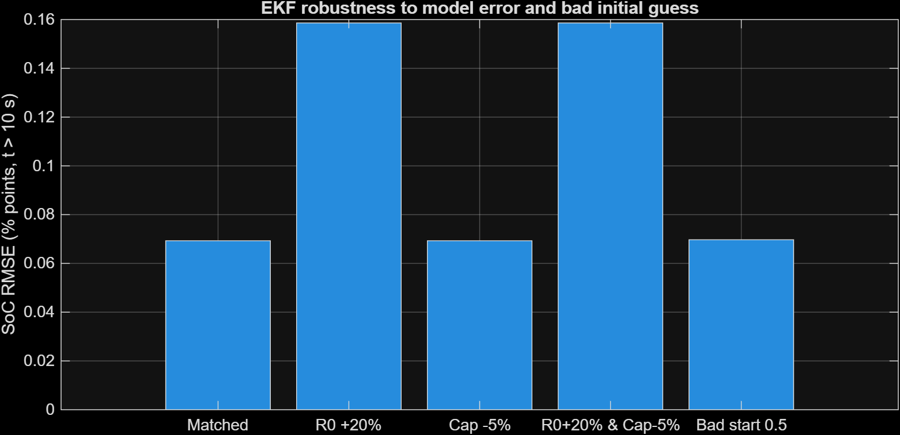

# EV Powertrain Simulation with EKF-Based State-of-Charge Estimation

A MATLAB/Simulink model of an electric vehicle driven over the WLTP Class 3 (Low phase) cycle, with a battery model and an Extended Kalman Filter (EKF) that estimates state of charge (SoC) from noisy voltage and current measurements only.

## What it does

1. **Drive cycle and driver:** WLTP Class 3 speed reference, followed by a longitudinal driver that produces accelerator and brake commands.
2. **Vehicle dynamics:** traction force minus aerodynamic drag and rolling resistance, integrated to vehicle speed.
3. **Drivetrain:** gear ratio, motor torque/power envelope, regenerative braking that fades out at low speed, friction brakes for the remainder, and a motor + inverter loss model. Output is electrical power (positive = discharge, negative = regen).
4. **Battery (truth model):** open-circuit voltage vs SoC lookup, series resistance R0, and one RC pair (R1, C1) for polarisation. Battery current is solved exactly from the power demand. Voltage and current sensors have added Gaussian noise (0.1 V, 0.5 A).
5. **EKF estimator:** two states, SoC and RC-branch voltage. It sees only the noisy voltage and current, never the true SoC.

## EKF model

States: x = [SoC, V1]

- SoC(k+1) = SoC(k) - I * dt / (3600 * Capacity_Ah)
- V1(k+1)  = a * V1(k) + R1 * (1 - a) * I, with a = exp(-dt / (R1 * C1))
- Measurement: V = OCV(SoC) - V1 - I * R0

The measurement Jacobian uses the numerical slope of the OCV curve. The filter runs at a fixed 0.1 s step.

## Results

All numbers are from `run_tests.m`. RMSE is computed after the first 10 s, so the start-up transient is excluded.

| Case | SoC RMSE |
|---|---|
| Matched model | 0.0693 % |
| R0 +20 % (EKF model error) | 0.1586 % |
| Capacity -5 % (EKF model error) | 0.0693 % |
| R0 +20 % and Capacity -5 % | 0.1586 % |
| Bad initial guess (50 % vs true 90 %) | 0.0697 % |

## Limitations

- The Low phase uses only about 1.5 % of the battery, so a capacity error barely shows up. Harder phases (Medium, High, Extra High) would test this properly.
- Sensor noise and the battery model are simulated, and the EKF uses the same model structure as the simulated battery. A real pack would show larger errors.
- No temperature or ageing effects, and OCV is a coarse 7-point lookup.

## How to run

1. Put `class3-1-Low.csv` in the project folder.
2. Open `ev_powertrain.slx` (solver: fixed-step ode3, step 0.1 s).
3. Run `init_params` and then `run_tests` for the results table, or `make_plots` to regenerate the figures.

## Files

- `ev_powertrain.slx`: Simulink model
- `init_params.m`: all vehicle, drivetrain, battery and EKF parameters
- `run_tests.m`: robustness tests
- `make_plots.m`: figure generation
